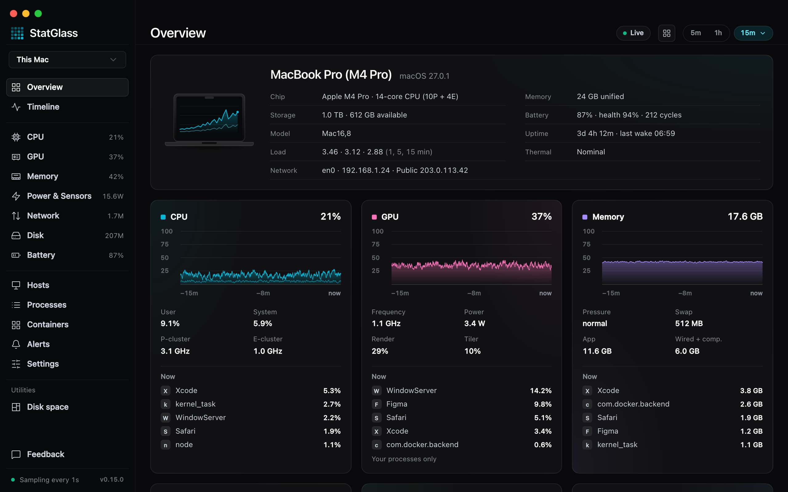
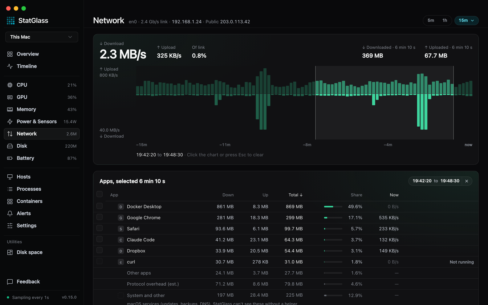
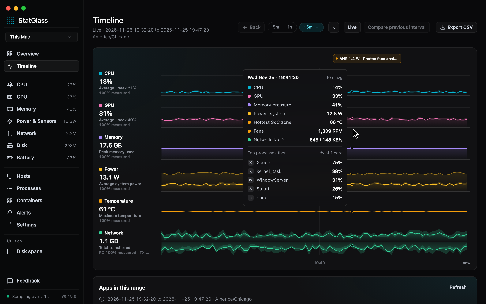
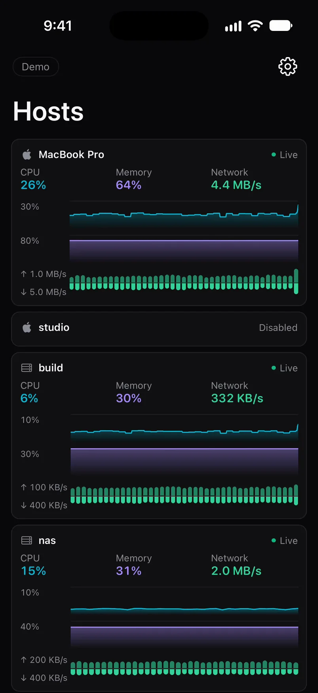
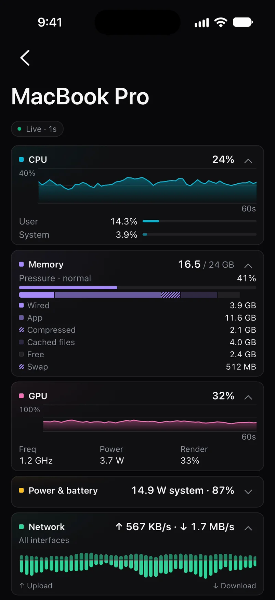

# StatGlass

A menu bar system monitor for Apple Silicon Macs that keeps history.

StatGlass shows CPU, GPU, memory, power and sensors, network, disk and battery once a second, and keeps up to 30 days of local history. When the fans spun up at 3pm, you can scroll back and see which process did it. It can also watch other Macs and Linux servers over SSH, and there's a read-only iPhone app for checking them from your phone.

It's free and open source. **Documentation, guides and a live demo are at [statglass.steamfield.io](https://statglass.steamfield.io).**

## Install

StatGlass needs an Apple Silicon Mac (M1 or newer) on macOS 26 or newer.

[Download StatGlass.dmg](https://github.com/steamfield/statglass/releases/latest/download/StatGlass.dmg), drag StatGlass into Applications and open it. The app is signed and notarized, and updates itself. See [Install StatGlass](https://statglass.steamfield.io/docs/install) for building from source and uninstalling.

## Documentation

- [What StatGlass measures](https://statglass.steamfield.io/docs/metrics)
- [The menu bar and windows](https://statglass.steamfield.io/docs/menu-bar-and-windows)
- [History and storage](https://statglass.steamfield.io/docs/history)
- [Monitor another Mac](https://statglass.steamfield.io/docs/remote-macs)
- [Monitor a Linux host](https://statglass.steamfield.io/docs/linux-hosts)
- [StatGlass for iPhone](https://statglass.steamfield.io/docs/iphone)
- [Updates](https://statglass.steamfield.io/docs/updates)
- [Privacy and data](https://statglass.steamfield.io/docs/privacy)

## StatGlass for iPhone

  
  

## Development

| Command | What it does |
| --- | --- |
| `bun run dev` | The full app with hot reload |
| `bun run dev:fast` | The interface only, in a browser with simulated data |
| `make check` | Lint, typecheck and every test. The pre-push hook runs it (`make hooks` installs the hooks) |

[`CLAUDE.md`](CLAUDE.md) covers the project layout and conventions, and [`plan/README.md`](plan/README.md) covers what's being built.

## License

Apache-2.0. See [`LICENSE`](LICENSE).
