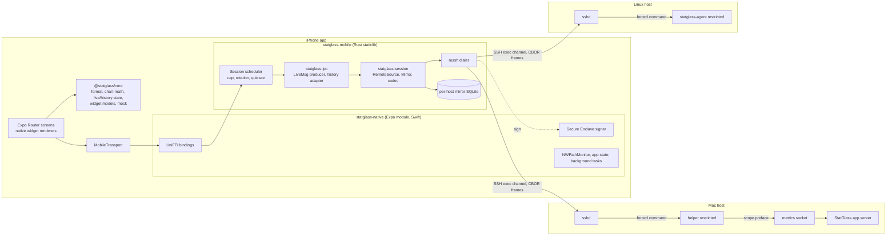

# RFC: StatGlass for iPhone

> **Changed 2026-11-25 (the user's decision, D-152):** the phone no longer mirrors history. The
> host answers bounded `Query::History` requests and the phone keeps answers in memory only.
> Sections 3.4, 3.5, 4.4 and 4.5 still describe the mirror; read them with D-152 and
> `plan/rfc-ios-polish.md` section 6. The body below is unchanged.

Status: Draft, revision 2, 2026-11-22. Revision 2 folds in a ce:devils-advocate architecture
review against the code (findings cited by file below), the decision that the popover is the
phone's host screen, and an explicit inventory of what the two apps share. Nothing here is
accepted; section 10 lists the decisions it asks for.

Related: [architecture](architecture.md), [remote Macs](remote-macs-execution.md),
[v4 remote hosts](v4-remote-hosts.md), [design system](design-system.md),
[decisions](decisions.md) (D-015, D-104, D-105, D-116, D-117, D-118, D-131).

## Summary

StatGlass for iPhone is a viewer for the Macs and Linux servers a person already monitors with
StatGlass. The phone never monitors itself. It connects to each host the way a Mac controller
does today: an SSH exec channel that reaches the bundled helper (Mac) or
`statglass-agent serve --stdio` (Linux) and speaks the existing CBOR session protocol. The phone
keeps a small mirror per host, so history and "last seen" survive bad signal and offline hosts.

The choices that carry the design:

1. The phone reuses the Rust session, sync and mirror code. That code is extracted from
   `statglass-remote` and `src-tauri` into crates both apps use (`statglass-session`,
   `statglass-ipc`) and wrapped for iOS in an Expo native module. The wire format does not change.
2. iOS cannot run `/usr/bin/ssh`, so the phone embeds russh behind a new dialer seam and holds a
   per-device key in the Secure Enclave. Hosts install that key as a forced-command key, and the
   host serves its sessions in a restricted scope that streams metrics and refuses disk scans and
   path queries.
3. Pairing is one QR scan from the StatGlass Mac app (or `statglass-agent pair` on Linux). The QR
   carries addresses, pinned host-key fingerprints and a short-lived, single-use pairing key. Each
   host's own tagged `authorized_keys` lines are the record of which phones it allows.
4. Tailscale is the recommended route away from home and needs no code in the app. Tailscale SSH
   is an optional keyless mode for Linux hosts.
5. The phone's host screen is the desktop popover's card stack, adapted for touch. The apps share
   data meaning, state logic, widget models and tokens; each draws its own elements and owns its
   own interaction (section 4.6). Sharing stops wherever the two platforms would change something
   for different reasons.

The repository becomes a Bun workspace: the desktop app stays at the root for now, with
`apps/mobile` and `packages/` beside it. iOS builds and App Store submission run locally or on
EAS, outside GitHub's macOS runners, because the hosted runner policy (D-118, D-131) allows only
the tag-triggered desktop release job on macOS.

## 1. Product

### 1.1 What it is for

The desktop jobs from [README section 3](README.md#3-jobs-to-be-done) carry over, narrowed to
remote hosts and to a phone's moments of use:

- Glance: "Is the build box / home server / work Mac fine right now?" Open the app, see every
  host's status and two or three headline numbers within a second or two.
- Look back: "The server was slow overnight. What happened?" Range charts, events and gaps for
  the last 24 hours to 30 days.
- Watch something run: keep a host's live CPU, memory and power on screen during a long job.

A phone is opened often and briefly, frequently on cellular, and is suspended the moment it leaves
the screen. The design assumes sessions of 5 to 60 seconds with a cold or half-cold connection.
That assumption drives several changes to shared session code (4.5): today's session ordering
suits long desktop sessions.

### 1.2 Who it is for

People who already run StatGlass on at least one Mac, or the Linux agent on a server. A person
with no hosts gets demo mode (1.4) and instructions to install StatGlass on a Mac first. The
phone app installs nothing on hosts.

### 1.3 Scope

Must, for 1.0:

- Pair with a Mac running StatGlass, and with Linux hosts through that Mac or through
  `statglass-agent pair`, by scanning a QR code.
- Hosts list with status, last-seen time and headline values from five-second summaries.
- Host screen (the adapted popover card stack) and module pages for CPU, GPU, Memory, Power and
  Sensors, Network, Disk, Battery (Mac laptops) and Linux cgroups, with Live, 1h, 24h, 7d and 30d.
- Events and explicit gaps, as on desktop.
- Live top processes for the open host, read-only, if open question 1 keeps them in scope.
- LAN and Tailscale routes.
- Specific error states for every failure in section 3.
- Demo mode on the existing mock transport, reachable from first launch.
- Optional Face ID app lock. Light and dark appearance. Dynamic Type and VoiceOver.

Should, soon after 1.0: Home Screen and Lock Screen widgets (stale-marked, 3.7), iPad layout,
manual host entry.

Won't, without a new decision:

- Monitoring the phone itself.
- Remote actions: process signals, Docker actions, settings changes, disk space scans. The phone's
  restricted session cannot run them (2.3).
- Push alerts while the app is closed (3.7, open question 6).
- Installing or updating StatGlass on hosts from the phone.
- Android, until users ask for it.

### 1.4 Experience

First launch shows one screen: what the app does, "Pair with your Mac", a secondary "Add a Linux
server" link, and "Try demo hosts". Demo mode runs the real screens on `createMockTransport`
with a "Demo" marker, and is what App Review sees (7.4).

Pairing a Mac: on the Mac, Settings → Hosts → "Pair iPhone". The Mac first checks that Remote
Login is on for this user and that remote monitoring is enabled, disclosing that change as Add
Mac does (D-105). It then shows a QR code and a six-character code. The phone scans; the Mac asks
"Allow 'Alex's iPhone' to view this Mac's metrics?"; after approval the phone lists the Mac and
the hosts the Mac can hand over (2.4), each with a checkbox, plus any it cannot hand over with
the reason. The phone connects, syncs, and lands on the hosts list. Target: under 30 seconds.

Pairing Linux without a Mac: `sudo statglass-agent pair` prints the QR and code in the terminal
and asks for approval there.

Hosts list: one row per host, ordered by the user. Rows use the compact popover card style: name,
OS glyph, status (Live, Connecting, Offline since 14:02, Needs attention), three headline values
with a short sparkline. Pull to refresh reconnects. Offline hosts still open and show mirrored
history up to the last sync, labelled as such.

Host screen: the popover's card stack. The popover panel is 360 × 680 px
([design-system.md](design-system.md), Spacing) and current iPhones are 375 to 440 pt wide, so
the same cards, card order, compact/expanded density, module accents, headline-value rule and gap
semantics carry over. What the phone changes:

- Navigation: large title, safe areas, swipe-back, and horizontal paging between hosts. A card tap
  pushes that module's page instead of "Open dashboard".
- Interaction: touch scrubbing and long-press to pin replace hover; a long-press card menu for
  density and reorder; pull to refresh; haptics on pin.
- Chrome: the interval pill becomes a connection pill (Live, LAN or Tailscale, frame age). The
  self-CPU footer and pause button are dropped.
- Type: the popover's type roles map to iOS text styles and scale with Dynamic Type (card title
  12 px → footnote, card figure 15 px → subheadline, and so on). Touch targets are at least 44 pt.

Module pages are the dashboard's module pages reshaped for one column: range control on top,
charts with scrubbing, events as markers and a list, the host's clock and time zone on the axis
(`src/core/host-clock.ts`).

Settings: Hosts (rename, reorder, routes, re-pair, "Update from Mac", remove), This iPhone (public
key, created date, rotate key, app lock), Data (live updates and history sync on cellular, storage
per host, clear mirrors), Appearance, Diagnostics (redacted log export, 3.8), About.

## 2. Connectivity and trust

### 2.1 Why the Mac's approach does not transfer

The Mac controller spawns `/usr/bin/ssh` with `BatchMode=yes` and relies on the user's
`~/.ssh/config`, SSH agent and `known_hosts` (`crates/statglass-remote/src/transport.rs`,
`ssh_command`). An iPhone has none of these and cannot spawn processes. The phone needs, in its
own process: an SSH client, a key, pinned host keys, resolved addresses, and a way to get its
public key onto hosts.

Everything after the channel opens transfers: handshake, negotiation, live, summaries, sync and
mirror. It does not transfer as-is, because the session code is entangled with OpenSSH process
handling (4.2).

### 2.2 Reaching hosts: LAN and Tailscale

Each host has up to three dial targets:

- LAN: the Mac's Bonjour name (`MacBook-Pro.local`) or a LAN hostname, not a literal IPv4
  address by default (DHCP changes it; literals break on IPv6-only networks).
- Tailscale: the MagicDNS name (`macbook-pro.tail1234.ts.net`).
- Tailscale fallback: the 100.x address, for tailnets without MagicDNS.

The phone races them with the existing LAN preference, generalized from two routes to N (4.2). It
re-races when `NWPathMonitor` reports a path change and drops a session on a route that just
disappeared. Today `network_changed` only promotes from Tailscale to LAN, and a dead LAN session
waits for the 30 s heartbeat (`source.rs:476-494`, `888-895`); dropping the dead route is a
change to shared code that the desktop also benefits from.

Tailscale's part is reachability and encryption. The Tailscale iOS app runs the VPN; StatGlass
dials names and addresses that only work while it is on. No Tailscale SDK, API key or account
access. The app explains failures:

- Every Tailscale dial fails and no interface has an address in 100.64.0.0/10 (`getifaddrs`):
  "Tailscale appears to be off on this iPhone", with a button to open the Tailscale app.
- Interface up, host silent: the host may be offline, asleep or blocked by tailnet access rules.
- iOS allows one VPN at a time; a corporate VPN user cannot run Tailscale at the same time.

Without Tailscale the app works on the home network. Docs recommend against exposing SSH to the
internet.

### 2.3 Authentication and the restricted session

Key options:

| Option | How it works | Verdict |
|---|---|---|
| Secure Enclave key | P-256 key generated in the Secure Enclave (`ecdsa-sha2-nistp256`). Never leaves the chip, not in backups, not exportable | Default |
| Tailscale SSH | `tailscaled` authenticates by tailnet identity; no client key. Linux, and the open-source `tailscaled` build on macOS only | Optional for Linux (open question 7) |
| Keychain Ed25519 key | Software key, `ThisDeviceOnly` | Fallback for hosts that allow only Ed25519 |
| Imported private key | User supplies a key file | Manual entry only |
| Stored password | | No. One-time bootstrap only (2.4) |

Each phone has its own key, so a second iPhone or an iPad is paired and revoked separately. Keys
use `kSecAttrAccessibleAfterFirstUnlockThisDeviceOnly`, so widget refresh can sign while locked
but the key never restores onto another device. Biometrics gate the app (optional lock), not
each signature, which would prompt on every reconnect.

The key alone is not enough. `serve --stdio` is a byte bridge to `metrics.sock`
(`statglass-remote-helper/src/main.rs:41-43`), and that socket serves every D-117 query,
including `SpaceStart`, `SpaceLargestFiles`, `SpacePath` and `SpaceSubtree`
(`statglass-proto/src/query.rs:21-56`). A key that can reach `serve --stdio` can start disk scans
and list file names and paths, as root on Linux (D-116). The server has no notion of who
connected (`statglass-remote/src/server.rs:18-35`, `94-130`). So the restriction has to be
enforced by the server, not only by the helper:

- The phone's line in `authorized_keys` carries a forced command with a scope and device tag:

  ```
  restrict,command="/Users/alex/Library/Application Support/com.tryopendata.statglass/bin/statglass-remote-helper restricted --device 7F3A2C" ecdsa-sha2-nistp256 AAAA... statglass-mobile:7F3A2C alex-iphone
  ```

  For the Linux agent, `--system` or `--socket` is baked into `command=` too.
- The helper (or agent) in restricted mode reads `SSH_ORIGINAL_COMMAND`, accepts only bare tokens
  (`serve`, `version`, `status`), ignores any client-supplied path or flag, and opens the metrics
  socket with a short local preface carrying `{ scope: restricted, device: 7F3A2C }`. The desktop
  sends shell-wrapped commands today (`transport.rs:48-81`, `164-171`); the phone sends bare
  tokens.
- The server's session for a restricted connection refuses every query outside an allowlist. The
  allowlist for 1.0 is: live, summaries, sync, recent rows, process interest if open question 1
  keeps it, and `UsageByApp`/`HistoricalUsage`/`UsageProcesses` only if open question 1 says so.
  All `Space*` queries are refused. Refusals use the existing `Error { code: Unsupported }`.
- The preface is between the helper and the server on the host. Helper and app ship together and
  the agent is one binary, so the SSH-side wire format does not change.
- The device tag also gives host-side "last seen" per phone and lets host logs tell phone sessions
  from Mac sessions (3.8).

`restrict` turns off forwarding and PTY allocation. A stolen, unlocked phone can watch metrics in
the allowed scope; it cannot get a shell, start scans, read paths or change settings. The tests
for this live at the server, not only in the helper.

The forced-command path must not move. The Mac app maintains a symlink in its data directory
(`~/Library/Application Support/com.tryopendata.statglass/bin/`, the same directory as the
sockets, `socket.rs:27-33`) on each launch. The agent's path is fixed by `AgentLayout`.

Tailscale SSH bypasses `authorized_keys`, so neither the forced command nor the device tag
applies; the phone gets whatever the tailnet policy grants. The UI says so when that mode is
chosen. Tailscale SSH's check mode sends a re-authentication URL, which the app shows as "Approve
in browser".

### 2.4 Pairing

The QR (CBOR, then base45; about 1 KB for a Mac plus ten hosts) contains the host's `HostId`,
name and OS; resolved dial targets, port and user; host-key fingerprints for every key type sshd
offers; an ephemeral Ed25519 pairing key; an expiry; and the six-character code.

When the Mac shows the QR, it adds the pairing key's public half:

```
restrict,expiry-time="202611221410Z",command="<helper> pair --nonce <n>" ssh-ed25519 AAAA... statglass-pairing:<n>
```

`expiry-time` without `Z` is read in the host's local time zone, so the line always uses UTC.
`restrict` needs OpenSSH 7.2 and `expiry-time` 7.7; macOS and current Linux distributions ship
newer versions, and pairing checks `ssh -V` output on the host when it can.

The flow:

1. The phone scans, generates its Secure Enclave key, and dials with the pairing key, verifying
   the host key against the QR's fingerprints.
2. sshd runs the forced `pair` command; the phone sends its public key, device name and model.
3. Approval is a short-request protocol, because control requests are capped at 10 s on both ends
   and handled synchronously (`socket.rs:230-233`, `252`, `261`, `277`): `pair` sends
   `PairStart` to the Mac app over the control socket, then polls `PairStatus` until approved,
   denied or expired. On Linux, where the agent binds no control socket (`socket.rs:34-42`), the
   interactive `statglass-agent pair` process binds a one-time owner-only socket named by the
   nonce, and the forced `pair` command talks to it.
4. On approval, the host writes the phone's restricted line, removes the pairing line, and returns
   the host bundle.
5. For each host the Mac monitors and can hand over, the Mac records an install intent (2.6) and
   applies it over its own SSH access.
6. The phone connects to each host with its own key.

The pairing key is a bearer secret for a few minutes. A photographed QR can start a pairing, but
only `pair` runs, OpenSSH expires the line even if StatGlass crashes, it is removed on first use,
and nothing completes without approval showing the device name and code.

Building the bundle: the Mac's saved hosts are SSH aliases (`EndpointConfig.lan/tailscale`,
`transport.rs:12-19`); hostname, user, port and proxy settings live in `~/.ssh/config`, and host
keys in `known_hosts`, possibly hashed. The Mac resolves each alias with `ssh -G` and looks up
keys with `ssh-keygen -F`. Hosts that cannot be handed over are listed on the phone with the
reason: an alias that uses `ProxyJump` or `ProxyCommand`, a `HostName` that is a literal LAN
address the phone may not route, or no stored host key.

Keeping the list current: the bundle is a snapshot. In 1.0, "Update from Mac" in phone Settings
shows a fresh QR on the Mac (no pairing key, only the bundle) and the phone reconciles: new hosts
offered, removed hosts marked. Pushing host-list changes over the session would be a new D-117
query and needs its own decision; deferred.

Manual pairing for hosts the QR flow cannot cover: enter address, user and port; compare the host
key fingerprint with `ssh-keygen -lf` output on the host, as the Mac guide does; then either copy
the phone's restricted line to install by hand, or authenticate once with a password or
keyboard-interactive prompt and let the app run `<helper> authorize-key` (or the agent's
equivalent). The password is never stored.

### 2.5 Editing `authorized_keys`

The Mac setup guide today does not create or edit authentication keys. Pairing does, so the rules
are part of decision 5:

- One implementation, in `statglass-remote` (the Mac app and the agent both depend on it), used by
  the helper's or agent's `pair` and `authorize-key` paths and by host-side revocation. Tests run
  against real `sshd` in the existing Docker fixtures.
- Only lines tagged `statglass-mobile:` or `statglass-pairing:` are added or removed. Other lines
  are never rewritten.
- A symlinked `authorized_keys` (dotfile managers) is followed and the target is edited; the link
  is not replaced by a plain file.
- Writes are atomic in the target's directory and keep 0600 on the file and 0700 on `~/.ssh`, so
  `StrictModes` keeps accepting it. The lock only protects StatGlass from itself; editors and
  `ssh-copy-id` do not take it, so the write re-reads and merges just before the rename.
- A non-default `AuthorizedKeysFile` or an `AuthorizedKeysCommand` cannot be detected without root
  on most systems. If the phone's first connection with its new key fails, the host is marked
  "Key not accepted by sshd" with instructions, rather than retrying.
- Config management may overwrite the file. A host where the phone's key stops working shows
  "This iPhone is no longer authorized" and offers re-pairing (3.2).

### 2.6 Who owns a phone's access

Each host's own tagged lines are the source of truth. Every StatGlass Mac host shows Settings →
Paired devices from its own `authorized_keys`, whoever installed the lines, with last seen from
the device tag. `statglass-agent devices` lists and revokes the same on Linux. So a phone can
always be revoked on a host directly, even if the Mac that installed it is gone.

The Mac controller keeps a durable per-host intent log for keys it distributes: install or revoke,
with a sequence number per device. It applies intents when it reaches a host, and a revoke always
supersedes an earlier install, so a queued install cannot resurrect a revoked phone. The Mac's
Paired devices view shows pending intents per host ("revoke pending: build-server offline").

Two Macs managing the same Linux host write the same tagged line for the same phone; the line is
idempotent per device tag. Revoking from either Mac removes it for both, which is intended: a
revoke means the phone should not have access.

The phone's Settings shows its key and "Rotate key", which pairs again and revokes the old tag.
Restoring onto a new iPhone brings back the host list but not the key; the app marks every host
"Re-pair this iPhone".

### 2.7 Host-key trust

The phone only connects to hosts whose fingerprints it holds, pinned through the QR or confirmed
in manual pairing. A changed host key blocks the connection and offers re-pairing, matching the
Mac's `StrictHostKeyChecking=yes`.

## 3. Edge cases

Each row is a test case for phase 5.

### 3.1 Network

| Case | Behavior |
|---|---|
| Wi-Fi to cellular mid-session | `NWPathMonitor` fires; drop the LAN session, re-race; Tailscale takes over if available. The live chart shows a short hole until recent rows arrive (4.5) |
| Tailscale off on the phone | Diagnose as in 2.2, offer to open the Tailscale app |
| Corporate VPN active | Name it: one VPN at a time |
| MagicDNS disabled | Fall back to the 100.x target |
| Tailnet ACL blocks phone → host:22 | Timeout on an up interface; mention tailnet access rules |
| Host LAN address changed | Bonjour name resolves the new address |
| Local Network permission denied | LAN dials fail with a policy error; show the Settings path. Tailscale keeps working |
| IPv6-only cellular (NAT64) | Resolve through `getaddrinfo` so NAT64 synthesis works; never parse IPv4 literals in Rust. App Review tests on such a network |
| Captive portal | Timeouts; no special handling |
| Low Data Mode, or cellular with live/sync off | Summary-only sync policy (4.5); history sync waits for Wi-Fi unless the user pulls to refresh |

### 3.2 Host state

| Case | Behavior |
|---|---|
| Mac asleep | Unreachable; "Offline since" and mirrored history. No Wake-on-LAN in 1.0 |
| StatGlass not running, or user logged out | The helper prints a stderr marker, like the agent's `AGENT_NOT_RUNNING`, and the dialer maps it to "StatGlass isn't running on <host>". The helper prints a generic error today (`main.rs:21-23`); the markers are new |
| Remote monitoring off on the Mac | A second marker: "Remote monitoring is off on <host>" |
| Host reinstalled, new database epoch | Existing behavior: full resync of that host's mirror |
| Host identity changed | `RemoteIdentity`; "Re-pair as a new host", old mirror kept read-only until removed (D-116) |
| Phone key removed | `RemoteAuth`; "This iPhone is no longer authorized on <host>" |
| Host key changed | Block, explain, re-pair (2.7) |
| Linux agent stopped or updating | `AGENT_NOT_RUNNING`; retry with backoff |
| Wide host (many series) | Live projected to the series on screen; history paged |

### 3.3 Versions

The phone ships through App Store review on its own schedule; hosts update from GitHub and the
agent's updater. Either side can be ahead for days.

- Handshake version ranges and feature negotiation already handle skew. The new obligation is a
  policy, recorded in a checked-in `compat/mobile-protocol.json`: the protocol range and features
  of the current and previous App Store builds. The desktop release script refuses to tag a build
  that drops anything listed there. How far back the phone supports hosts is open question 4.
- `RemoteIncompatible` splits into "Update StatGlass on <host>" and "Update this app".
- The proto skew tests add the oldest supported phone build as a pinned peer.

### 3.4 Phone lifecycle

| Case | Behavior |
|---|---|
| App sent to background | `beginBackgroundTask`, then `quiesce()` (4.5): stop new work, wait for in-flight mirror ingests, close sessions. Never block the main thread on a join |
| App returns to foreground | Open host first, then the rest, under the session cap |
| App killed during a mirror write | WAL plus "rows and cursor commit together"; resume from the committed cursor |
| Low Power Mode or serious thermal state | Summary-only policy; history sync deferred |
| 20+ hosts | Summaries under a concurrency cap with rotation (4.5) |
| Phone storage low | Stop syncing and say so; mirrors prune to their caps |
| Restored to a new phone | Re-pair prompt (2.6) |
| iCloud backup | Mirrors excluded (`isExcludedFromBackup`); host list and settings included |

### 3.5 Gaps and unsynced spans

The phone matches current desktop behavior. Contrary to architecture.md's sync section, no code
writes or trims provisional `source_offline` gaps today (the reason exists only in the schema enum
and renderers, `statglass-schema/src/history.rs:272`). Desktop shows "synced through" for remote
hosts (`src-tauri/src/remote/registration.rs:62-66`), and `statglass-query` reports unsynced spans
as `not_synced` (`statglass-query/src/answer.rs:43`, `271`).

So the phone stores only the host's own gaps, which already cover the host's sleep and
not-running periods. An unreachable host shows a chart ending at the last synced bucket with
"offline since". A span the phone has not synced is reported by Rust with the existing
`not_synced` meaning, not a phone-specific state invented in TypeScript (the data-boundary rule:
Rust owns what data means). architecture.md's description of provisional gaps is stale and is
corrected separately.

### 3.6 Time

Remote timestamps are authoritative (D-104). Labels use the host clock offset (`HostClock`), so a
phone with a wrong clock or another time zone labels host events correctly, with the host's time
zone shown when it differs.

### 3.7 Background and notifications

iOS suspends apps seconds after they leave the screen; no SSH session survives in the background,
and no alert reaches a closed app without a push service. StatGlass has no backend, and an APNs
key cannot ship in an open-source repository. 1.0 has no alerts while closed. Widgets, later,
refresh through `BGAppRefreshTask` and WidgetKit reloads, which iOS schedules opportunistically,
and always show "as of 14:02". Open question 6 covers real alerts.

### 3.8 Security, privacy and diagnostics

- Nothing leaves the phone except SSH traffic to the user's hosts. No analytics or crash SDK;
  Apple's opt-in crash logs only.
- Mirrors use `NSFileProtectionCompleteUntilFirstUserAuthentication`, matching the key's
  accessibility. The app lock blurs the app switcher snapshot.
- SSH options match the Mac's hardening: no forwarding, no PTY, connect timeout, keepalives.
- Diagnostics: Rust `tracing` writes to a bounded on-device log; Settings → Diagnostics exports
  it with host names, paths and process names redacted, through the share sheet. Hosts log the
  device tag of restricted sessions, so "which phone was connected" is answerable on the host.

### 3.9 SSH features not in 1.0

ProxyJump, `ProxyCommand`, certificates, `Match` blocks and other `~/.ssh/config` features.
Tailscale covers most bastion use; ProxyJump can come later through russh `direct-tcpip`.

## 4. Technical architecture

### 4.1 Overview



### 4.2 The Rust mobile core

Reuse target: everything from the SSH channel inward (handshake, negotiation, live, summaries,
sync, mirror) and the code that turns a host's live hub into the `LiveMsg` stream the frontend's
host store reduces. Re-implementing any of it in TypeScript would duplicate one-way-door semantics.

What the review found about where that code lives decides the extraction:

- `statglass-remote` mixes the client with controller-side management (`install`,
  `agent_install`, `trust`, `rr`, `control`, all spawning processes) and with host serving
  (`server`, `host_server`). The client and the rest depend on each other in both directions:
  `transport.rs:304` uses `install::setup_ssh_error`; `source.rs` uses `server::status_from_wire`
  and `server::process_from_wire`; `calls.rs` holds the host's `Answering` beside the client's
  pending calls; client tests use `server::tests::provider()`; `control.rs` and `install.rs` use
  `transport::sh_c` and `helper_command`. A client/host split along the RFC's first line would
  create a cycle.
- The types and producers the phone needs are in `src-tauri`, which `statglass-mobile` cannot
  depend on: `LiveMsg`, `HistoryRequest`, `HistoryPage`, `TierRequest` (`src-tauri/src/ipc.rs`),
  `CommandError` (`error.rs`), `RemoteHostStatus` (`remote/contracts.rs`), the live-channel
  producer with backfill, holds, thinning and projection (`live.rs`, `live/registry.rs`, about
  1,300 lines), mirror history routing (`remote.rs:92-188`, `state.rs:238-261`), and the status
  mapping (`remote/registration.rs:108-303`). `LiveProcess.refusal` pulls in process-signal types.

The extraction, in phase 2:

1. `statglass-session`, a new crate below `statglass-remote`: codec, the client half of calls, wire
   conversions (or moved into proto), `HostClock`, `Mirror`/`MirrorSink`, and `RemoteSource`
   behind a dialer. It spawns no processes. `statglass-remote` keeps the OpenSSH dialer,
   controller-side management, host serving and the `authorized_keys` module, and depends on
   `statglass-session`.
2. `statglass-ipc`, a new crate for the IPC types both apps use, the live-channel producer, the
   mirror history adapter and the remote status mapping. `src-tauri` keeps windows, tray, settings,
   commands and the local source, and depends on `statglass-ipc`. Desktop-only fields (process
   signal refusals) stay in the shell's types or become optional extension fields; the phone's
   `LiveProcess` has no refusal.
3. A dialer seam. Today `dial` (`transport.rs:207-295`) captures and classifies remote stderr,
   kills the child on handshake failure, holds the child and stderr task in `SshSession`, and lets
   `race_routes` cancel losers by dropping futures with `kill_on_drop`; route promotion calls
   `crate::connect` directly (`source.rs:490`). The seam is a per-host dialer passed into
   `RemoteSource`, with its own endpoint type (targets, port, user, pinned keys), returning
   `DialedStream { reader, writer, stderr, close }`. Each dialer classifies its own errors:
   OpenSSH parses stderr, russh maps typed errors. The shared handshake keeps only the
   `AGENT_NOT_RUNNING`-style marker checks. The race becomes generic over N targets. The russh
   dialer gets cancellation tests that check the TCP connection actually closes, because dropping
   a russh future does not close the connection unless its handle is dropped.
4. Engine on iOS. `RemoteSource` and `Mirror` use engine types, and `HostClock` calls
   `statglass_engine::continuous_ns`, which uses `CLOCK_BOOTTIME` on every non-macOS target
   (`statglass-engine/src/clock.rs:34-35`); libc does not define it for Apple targets. Fix:
   `CLOCK_MONOTONIC_RAW` for `target_vendor = "apple"`. iOS is `unix`, so engine's `disk_space`
   and `docker` modules compile in, and collect brings `bollard` and `hyper`. For 1.0 the phone
   links engine if it compiles and the binary size is acceptable, with those modules gated off for
   iOS. A collector-free phone means extracting bus, live hub, ring, `Source`, clock and
   `HistoryStore` and moving `ProcessSample` to schema; that is the fallback, decided by open
   question 2.
5. `statglass-mobile`, the phone's shell: a registry of remote sources, the session scheduler
   (4.5), mirror paths and policy (4.4), and the command surface (4.3). It depends on
   `statglass-ipc`, `statglass-session`, proto, store and schema (and engine per step 4), never on
   `statglass-remote`. `crate-edges.json` records the new crates and forbids
   `statglass-mobile -> statglass-remote`.

The Secure Enclave signer: russh supports custom signers through its `Signer` trait (implemented
for its agent client). The trait's method calls a UniFFI callback into Swift, Swift signs with the
Secure Enclave key, and Rust converts the DER signature to SSH's `(r, s)` form. The trait changed
shape between 0.43 and 0.61, so russh is pinned and the signer has its own test.

### 4.3 The native bridge

`statglass-mobile` is built for `aarch64-apple-ios` and `aarch64-apple-ios-sim`, packaged as an
XCFramework by `scripts/mobile/build-rust-ios.sh`, and vendored by a local Expo module at
`apps/mobile/modules/statglass-native/`. UniFFI generates Swift bindings. The module is a pipe:

- Commands: `call(method, argsJson) -> resultJson`, carrying `statglass-ipc` types in the same
  `{ status, data | error }` shape the desktop uses.
- Streams: Rust pushes `LiveMsg`, summaries and status through a UniFFI callback; Swift forwards
  them as Expo module events tagged with a subscription id. Because the producer is the shared
  `statglass-ipc` code, the stream obeys the ordering contract `reduceLive` depends on
  (`ipc.rs:87-111`), and the phone shares `live-state.ts` unchanged.
- Signer: a UniFFI callback interface implemented in Swift.
- Lifecycle: `start()`, async `quiesce()`, `resume()`, `pathChanged(path)`. None of these block
  the calling thread.

JSON keeps one type system: Rust types, exported to TypeScript by specta. Swift never interprets
metric data. Widgets, later, get a small UniFFI record for summaries.

Type export: `src/core/generated/bindings.ts` mixes types with Tauri `invoke` calls and is
produced by `src-tauri/examples/export_bindings.rs`. Split it into a runtime-free `types.ts` and a
desktop-only `commands.ts`. Types in `statglass-ipc` are exported once, by one exporter, into
`types.ts`; the mobile facade's few extra types join the same export. Two exporters writing one
file risk name collisions, so there is one. Phase 0 checks whether tauri-specta supports the split
or whether a plain specta exporter produces `types.ts` and tauri-specta produces only commands.

### 4.4 The phone's mirror

Desired retention per host:

| Tier | Kept on phone | Estimate at 150 series |
|---|---|---|
| S10 | not stored; recent rows only while connected | 0 |
| M1 | 24 hours | 1,440 rows × ~2 KB ≈ 3 MB |
| M15 | 30 days | 2,880 rows × ~2 KB ≈ 6 MB |
| Events, gaps, layouts | 30 days | under 1 MB |

Default caps 25 MB per host and 250 MB total. The row sizes are architecture.md's estimates;
phase 5 measures them.

None of this needs a protocol change, but the current shared code cannot express it:

- The session hardcodes `tiers: [Tier::S10, Tier::M1, Tier::M15]` (`source.rs:306`) and gives S10
  a full-day floor (`mirror_sink.rs:51-57`). Unchanged, S10 alone is about 17 MB per host on first
  connect.
- `Mirror::prune` uses `Retention::mirror_default()` and overrides only `max_bytes`
  (`mirror.rs:204-207`).
- `TierChoice::Auto` picks S10 for ranges up to 24 h unless an S10 prune or hole is recorded
  (`statglass-store` reader, `reader.rs:276-300`), so a mirror without S10 returns empty 1h and
  24h charts. It picks M15 for 7d only when `m1_rolled` is set, which only roll-down writes, so a
  pruned 24 h M1 may draw one day in a 7-day chart.
- `TierRequest` has no `M15` (`ipc.rs:289-295`).
- Cursors are one ascending seq per tier, so extending M15 from 7 to 30 days means restarting that
  tier's cursor and downloading the whole range again.

So phase 2 adds a `MirrorPolicy` to `RemoteSource` and `Mirror` (tiers to sync, per-tier floor,
retention), makes tier selection for mirrors use the policy's coverage instead of S10/roll-down
markers, and adds an explicit M15 choice to `TierRequest`. First pairing syncs 24 hours of M1 and
30 days of M15 in one pass on Wi-Fi, or 7 days of M15 on cellular with a one-time full M15 resync
later on Wi-Fi; the resync cost is accepted rather than adding backward paging.

Remote historical process attribution stays out (D-104).

Data cost, estimated: live frames projected to about 20 series are roughly 100 B/s before SSH
overhead (about 0.4 MB an hour); unprojected 150-series frames about 2 MB an hour. A first sync
under the policy above is single-digit megabytes per host. Phase 5 measures these.

### 4.5 Sessions on a phone

`RemoteSource` was built for long desktop sessions:

- each `RemoteSource::start` creates its own OS thread and current-thread runtime
  (`source.rs:132-145`), and each mirror's `HistoryStore` adds a writer thread; 20 hosts would be
  40+ threads;
- `sleep()` drops the session future mid-await (`source.rs:196-199`), while ingest runs in
  `spawn_blocking`, which cannot be cancelled, so there is no way to wait for a commit;
- `stop()` joins the source thread (`source/control.rs:43-48`);
- sync starts on every connect regardless of interest (`source.rs:299`, `413-421`), and recent
  rows are requested only after every tier finishes syncing (`source/recent.rs:17`), so a
  reconnecting live chart waits for a full catch-up.

Changes, all in shared code so the desktop gets them too:

- A sync policy on the session's control state: off, summary-only, or tiers with priority. The
  hosts list runs summary-only; an open host runs its tiers.
- Recent rows before durable sync when detail interest starts.
- An injectable runtime handle, so the phone runs all sources on one multi-threaded runtime.
- An async `quiesce()` that stops new work and resolves after in-flight ingests commit.
- Network change drops a session whose route disappeared (2.2).

`statglass-mobile`'s scheduler owns what is phone-specific: at most N concurrent sessions (start
with 8), rotation for the hosts list, the open host first, and mapping app state and path changes
to `quiesce`/`resume`/re-race.

On the host, a phone is one more remote session, and D-104's interest aggregation keeps a Mac
controller and a phone independent.

### 4.6 What the two apps share, and what they do not

The goal is the same components and design on both platforms without a change on one platform
breaking or bending the other. The rule for every case:

> Share a thing when both platforms would change it for the same reason. Keep it per platform
> when they would change it for different reasons.

The test: "If the desktop changes this, should the phone change too, without anyone deciding?"
Yes means shared. "It depends" means per platform. A shared module that needs a platform flag to
answer has failed the test and is forked.

#### Inventory

| Layer | Shared | Why | Notes |
|---|---|---|---|
| Rust session, sync, mirror, IPC types, live producer | Yes | One meaning of the data | `statglass-session`, `statglass-ipc` (4.2) |
| `@statglass/core`: formatters, `chart-math`, `live-state`, `history-state`, `host-clock`, `series-key`, `query-keys`, `remote-errors` | Yes | Same meaning | Pure TypeScript today, except the Tauri adapters listed below |
| Mock transport, scenarios, widget fixtures (`sample-props`) | Yes | One set of test and demo data | Demo mode and both galleries |
| Generated types | Yes | Rust is the source of truth | After the `types.ts` split |
| Widget models (props → view model) | Yes, per widget, when the phone renders it | What a CPU stream chart shows is one decision | See below |
| Popover composition: card order (`popoverSlots`), subscribed series (`POPOVER_SERIES`), density semantics | Yes | Same host screen | Moves from `routes/popover/_lib` into core |
| Color tokens, module accents, status colors, motion durations, reduced-motion semantics | Yes | One visual identity | Shared token source (6.1) |
| Type roles | Names yes, sizes no | Same hierarchy, different scales | Desktop px; iOS text styles with Dynamic Type |
| Data hooks and per-host store | Not in phase 1 | Today they read `document.visibilityState`, call `transport.windowLabel()` and depend on desktop brush and range stores (`host-store.tsx:69-120`, `use-module-end.ts`, `use-range-scope.ts`) | The phone writes thin hooks over core; extract a shared package only after both sets converge |
| Spacing, radii, card padding | No | Density and touch targets differ | |
| Rendered elements and renderers (DOM SVG/divs, uPlot; `react-native-svg`, Skia) | No | Different primitives | Thin, per platform |
| Card chrome, layout, grids | No | Different surfaces | |
| Interaction (hover, keyboard, Radix menus; gestures, haptics, sheets) | No | Different input | |
| Motion implementation | No | Different engines | Durations shared through tokens |
| Accessibility implementation | No | Different APIs | Labels and value text come from models |
| Navigation and routes | No | Different routers | |
| Desktop-only features (tray, settings, Docker actions, disk space, process control, updates, CLI, star prompt) | No | No phone equivalent | |
| Platform hooks (`use-element-size`, brush, drag, window visibility) | No | DOM or window specific | |

#### Widget models

The widget boundary rule already makes `src/app/widgets/` render-only: props in, no transport,
stores or router. The popover widgets are SVG and divs on top of `chart-math`, not uPlot (only
dashboard charts use uPlot). About 1,500 of their roughly 5,000 lines are geometry and state
logic: `StreamArea`, `HeatMatrix`, `MirrorBars`, `InlineBar`, `StackBar`, `CoreTiles`,
`RingGauge`, `GapBand`, `ChartAnnotation`, `WindowTicks`.

Each widget the phone renders splits into a model in `@statglass/core` (a pure function from the
widget's existing props type, plus explicit inputs such as width and density, to a view model:
token names for colors, final strings, final geometry; no React, DOM, React Native or platform
parameter) and a renderer per platform that adds elements, chrome, motion and interaction, aiming
for tens of lines. The desktop component keeps its name and props, so routes do not change. The
phone twin takes the same props type.

#### Transport

Shared code that needs transport takes `Pick<Transport, "queryHistory" | "subscribeLive" | ...>`
rather than a new set of capability interfaces; one extra implementation does not justify ten
interfaces. `MobileTransport` implements hosts, live, history, events and summaries. It does not
implement the Docker methods: they take no host and are local-only (`contracts.ts:128-172`);
Linux containers reach the phone as `cgroup.*` series (D-116).

#### Guards against brittleness

1. Pull, never push. Code moves into a shared package in the same PR that adds its second
   consumer. No bulk moves of `src/app/hooks` or `src/app/widgets`. A widget the phone never
   renders keeps its logic in the desktop app.
2. No platform code in shared packages. `packages/core` cannot import `react`, `react-dom`,
   `react-native`, `expo-*` or `@tauri-apps/*`, or use `window`, `document` or `navigator` (Biome
   `noRestrictedImports` and globals rules, plus the write hook). The current exceptions move to
   the desktop app in phase 1: `generated/bindings.ts` (becomes `commands.ts`),
   `transport/native.ts`, `transport/native-docker.ts` and `app-transport.ts`. Models take
   measurable inputs, never a platform enum.
3. Fork instead of flagging. When a shared model needs an option only one platform uses, that
   platform copies the model and the copy is noted in the package README.
4. Tested once, rendered twice. Model tests assert view models from the shared fixtures; each
   app's gallery renders the same fixtures. A semantic change fails both apps' suites in one CI
   run, which is intended. Pixel comparison stays within each platform.
5. Every shared change is checked by both apps: path filters run desktop and mobile typecheck and
   tests on Linux CI for any change under `packages/`.
6. The desktop's performance gates hold. Extracting a model is a pure refactor; render-count
   tests, `e2e-perf` and the idle-CPU budget stay green, and models stay pure and allocation-light
   on the 1 Hz path.
7. Each app pins its own React (6.2), so the phone never forces the desktop's React upgrades or the
   reverse.

#### What would change this

If the phone design turns out to be the popover with almost no divergence, rendering the existing
widgets in one webview (an Expo DOM component for the card stack, or Tauri mobile) shares more for
less work. Phase 0 builds the CPU card both ways, natively from a shared model and as a DOM
component, and measures frame time, memory, scroll and touch feel before committing. Expo DOM
components for individual charts stay rejected: each is a separate WKWebView with its own JS
context.

If StatGlass later targets three or more platforms and UI churn outpaces platform differences, a
universal component layer becomes worth evaluating (react-strict-dom first, since it renders plain
DOM on web). Not for a Mac app plus an iPhone app.

### 4.7 The Expo stack

Starting point: the `stacks` registry's `mobile-expo` stack, app half only: Expo Router with typed
routes, NativeWind on its CSS-first line with Tailwind v4, TanStack Query with one production
`QueryClient` (one query retry, no focus refetch), jest-expo and React Native Testing Library with
real providers, Metro config, `expo install --check`, and generated (uncommitted) `ios/` through
prebuild. Dropped: the Hono API, Postgres, Drizzle, the zod schemas package and Clerk.

Added: `react-native-svg` (widget renderers), `@shopify/react-native-skia` only if phase 0 shows
module-page charts need it, `react-native-gesture-handler` and Reanimated (in the stack) for
scrubbing, `expo-camera` (QR), `expo-local-authentication` (app lock), `expo-background-task` and
an Apple targets config plugin (widgets, later), and the local `statglass-native` module. Key
generation and signing are custom Swift in that module; `expo-secure-store` stores secrets but
does not create or sign with Secure Enclave keys.

## 5. Alternatives considered

### 5.1 Tauri 2 mobile

Tauri 2 builds iOS apps, would reuse the Rust natively (no UniFFI) and the React components as
they are. With the popover as the host screen, this is a closer call than revision 1 said. Not
chosen because the parts that must be rebuilt for a phone (navigation stack, swipe-back, touch
scrubbing, sheets, iOS lists, Dynamic Type) are rebuilt either way, and the iOS integrations the
app needs (Secure Enclave keys, camera, widgets, background tasks, app lock) are first-party or
well-trodden in Expo and custom plugins in Tauri. The phase 0 CPU-card comparison is the evidence
that could reverse this; the phase 1 and 2 extractions serve Tauri mobile equally.

### 5.2 SwiftUI

Most native, and widgets are SwiftUI anyway. Reuses the Rust through the same UniFFI layer but
none of the TypeScript: formatters, chart math, widget models, mock transport and fixtures would be
written twice and drift. Not chosen; widgets will be the SwiftUI part of the Expo app.

### 5.3 Relay through the Mac

One connection to the user's Mac, which mirrors every host. Needs a multi-host session capability
(a wire format change) and fails whenever that Mac sleeps. The Mac is the pairing hub instead.

### 5.4 An HTTP or WebSocket listener on hosts

D-104 and D-116 add no network listener deliberately, and a listener means designing
authentication, TLS and pinning from scratch. SSH provides them, plus forced commands.

### 5.5 Embedding Tailscale (`libtailscale`)

Avoids the separate app and the one-VPN limit, but users authenticate the app into their tailnet
separately, the binary grows and releases couple to Tailscale's. Deferred until it is shown to be
a real barrier.

## 6. Repository layout

### 6.1 Target tree

The desktop app stays at the root for now. Moving it into `apps/desktop` touches every
path-matching config (Makefile, `scripts/`, Biome overrides, `.claude/hooks/*`, `.claude/rules`,
`.agents/rules`, `scripts/agent-config`, `scripts/rename-statglass.py`, `bench-coalition.sh`,
`.pre-commit-config.yaml`, `src-tauri/examples/export_bindings.rs`,
`crates/statglass-store/tests/usage_volume.rs`, docs-site aliases) and buys little: accidental
resolution is controlled by Bun's linker mode and Metro's resolver, not by folder layout. Revisit
after the mobile MVP (open question 3).

```
statglass/
  package.json               desktop app and workspace root ("workspaces": ["apps/*", "packages/*", "docs-site"])
  src/app/                   desktop React app (unchanged)
  src/desktop-transport/     Tauri adapters moved out of core (native*.ts, app-transport.ts, commands.ts)
  src-tauri/                 desktop shell
  apps/
    mobile/
      app.config.ts          bundle id, team and name from env, so forks build their own
      src/app/               Expo Router routes
      src/widgets/           native widget renderers (react-native-svg)
      src/hooks/             thin data hooks over @statglass/core
      src/transport/         MobileTransport
      modules/statglass-native/   Expo module: Swift, podspec, vendored XCFramework
      test/                  jest-expo + RNTL
  packages/
    core/                    @statglass/core: today's src/core minus Tauri adapters, plus widget models
                             and popover composition; generated/types.ts
  crates/
    statglass-session/       client session, RemoteSource, Mirror, codec (new)
    statglass-ipc/           shared IPC types, live producer, history adapter (new)
    statglass-mobile/        UniFFI facade (new)
    statglass-remote/        OpenSSH dialer, controller management, host serving, authorized_keys
  docs-site/                 keeps its @statglass/widgets and @statglass/tokens.css aliases
  compat/mobile-protocol.json
  scripts/mobile/build-rust-ios.sh
```

Tokens: desktop and docs-site already share `src/app/styles/tokens.css` (docs-site aliases it as
`@statglass/tokens.css`, and imports the desktop widgets as `@statglass/widgets`). The phone needs
the color, accent and motion values. Phase 0 checks whether NativeWind reads `theme.css` directly
and whether Skia or SVG renderers can use the values (they need concrete colors). If both work, the
phone imports the same file. If not, a small generator emits a native theme and a plain color map
from `theme.css`, keeping `theme.css` the single source. No `@statglass/tokens` package is created
until a second file format is actually needed, and the name avoids colliding with docs-site's
existing alias.

`@statglass/react` and `@statglass/ui-native` are not created: the hooks are not DOM-free today,
and the phone is the only consumer of native components.

### 6.2 Workspace rules

- Each app pins its own React. Shared packages declare `react` as a peer only where they use it
  (core does not). Metro resolves `react` and `react-native` only from `apps/mobile/node_modules`;
  a CI check fails if the mobile bundle contains two copies of React. Desktop and docs-site stay on
  19.3 on their own schedule.
- Pin `vite` (root `"vite": "latest"`) before any lockfile regeneration, so the restructure cannot
  silently bump a major version.
- Shared packages export raw TypeScript; Vite and Metro compile them. Metro's `watchFolders`
  includes `packages/`.
- Boundaries: Biome `noRestrictedImports` and the write hook enforce guard 2 in 4.6, plus
  `apps/mobile` never importing `react-dom`, `@tauri-apps/*` or `src/app`, and the desktop never
  importing `react-native`.
- Rust: `crate-edges.json` records `statglass-session`, `statglass-ipc` and `statglass-mobile`.
- Mobile JS tests run on Node with jest-expo, never `bun test`.

## 7. Build, CI and release

### 7.1 What runs where

| Check | Where | Why |
|---|---|---|
| Biome, TypeScript, Vitest (desktop, core), jest-expo (mobile) | Linux CI | No macOS needed |
| `expo export` for iOS (JS bundle), `expo install --check`, single-React check | Linux CI | Metro resolution and SDK drift without Xcode |
| `statglass-mobile` in the Linux Rust gate | Linux CI | Joins `LINUX_CRATES` automatically; does not cover `target_os = "ios"` branches |
| `cargo check --target aarch64-apple-ios-sim -p statglass-mobile` | Local pre-push hook, triggered by any change in its dependency closure (computed with `cargo metadata`) | Breakage often starts in engine, session, store or proto, as the clock issue shows |
| `xcodebuild` simulator build, native module tests | Local `make mobile-check` | Needs Xcode |
| Release build and submission | Local or EAS (7.2) | Hosted runner policy |

The hosted runner policy (CLAUDE.md, D-118, D-131) allows exactly one GitHub-hosted macOS job, the
desktop release job on `v*` tags. This RFC does not propose changing it.

### 7.2 Signing and submission

Two compliant options, open question 5. Local: `scripts/release-mobile.sh` runs prebuild, builds
the XCFramework, archives with `xcodebuild` and uploads with an App Store Connect API key from the
local keychain, matching how desktop releases are cut (D-131). EAS Build and Submit: Expo's macOS
machines, not GitHub-hosted, but a third party holds signing credentials and free-tier limits apply
(check current terms). Recommendation: local first.

Bundle id `com.tryopendata.statglass.mobile`; team from the existing individual Apple Developer
account. `app.config.ts` reads bundle id, team and name from environment variables with those
defaults, so forks sign their own copies. No credentials in the repository.

### 7.3 Versions

The apps version independently: desktop `v0.x.y`, mobile `mobile-vX.Y.Z` with its own changelog
section and monotonic build numbers. The contract between them is `compat/mobile-protocol.json`
and the skew tests (3.3).

### 7.4 App Store specifics

- Review uses demo mode; the review notes say so.
- Purpose strings: camera, Local Network, Face ID.
- Privacy label: Data Not Collected, true while no analytics or crash SDK is added.
- Export compliance: the app uses SSH. The `ITSAppUsesNonExemptEncryption` answer and any annual
  self-classification report are checked against Apple's current guidance before the first
  submission.
- IPv6-only NAT64 networks are part of review (3.1).
- D-015 covers the Mac app (the sandbox removes its collectors). The iOS app collects nothing
  locally and only ships through the App Store; a new decision records the difference.
- License: Apache-2.0 is compatible with App Store distribution. No GPL code in the iOS binary;
  `deny.toml` covers Rust and a license check covers mobile JS dependencies.

## 8. Phases

### Phase 0: spikes

Each on a throwaway branch with a written result:

- russh dialer behind a prototype seam, from a macOS test binary, against a real Mac helper and
  the Linux agent in Docker, including cancellation closing the TCP connection.
- `statglass-proto`, `statglass-store`, the client half of `statglass-remote` and engine compiled
  for `aarch64-apple-ios-sim`, with the clock fix; binary size recorded.
- UniFFI async call and callback in a bare Expo dev build.
- Secure Enclave key signing an SSH authentication through russh's `Signer`.
- The CPU card built natively from an extracted model and as an Expo DOM component; frame time,
  memory, scroll and touch feel on the oldest supported iPhone.
- NativeWind and the renderers reading `theme.css`.
- The `types.ts`/`commands.ts` export split.

Exit: each spike works or has a named fallback chosen; the CPU-card result settles 5.1.

### Phase 1: workspace and core (desktop behavior unchanged)

Bun workspaces with the desktop at the root, `vite` pinned, `packages/core` from `src/core` with
the Tauri adapters moved out, the types export split, boundary rules, the single-React check.
Exit: `make check`, `bindings-check`, Playwright and `e2e-perf` pass, gallery screenshots match.

### Phase 2: shared Rust

`statglass-session` and `statglass-ipc` extracted, the dialer seam with OpenSSH and russh
implementations and N-route racing, `MirrorPolicy` and tier selection for mirrors, explicit M15,
sync policy, recent-before-sync, injectable runtime, `quiesce()`, dead-route drop on network
change, the clock fix, `statglass-mobile` and the XCFramework script, the dependency-closure
pre-push trigger. Exit: desktop remote tests pass on the OpenSSH dialer; the same tests pass on
russh; the facade runs a full session in the simulator with a pre-installed key; desktop
`e2e-perf` and idle-CPU unchanged.

### Phase 3: host-side pairing and restricted sessions

Restricted mode with device tags in the helper and agent, the scope preface and server-side query
allowlist, helper stderr markers, `pair` with the start/poll approval protocol and the Linux
one-time socket, the `authorized_keys` module and its rules, the stable helper symlink, host-side
Paired devices and `statglass-agent devices`, the Mac's per-host intent log, bundle resolution with
`ssh -G` and `ssh-keygen -F`, "Update from Mac". Exit: server-side refusal tests for every
disallowed query; expiry without StatGlass running; single use; denial; revoke superseding queued
install; symlinked `authorized_keys`; permission preservation; real `sshd` in Docker.

### Phase 4: Expo app MVP

Onboarding, demo mode, QR pairing, hosts list, host screen from the popover cards (widget models
extracted one at a time as each native twin is built), module pages, events, settings, app lock,
diagnostics export, error states. Exit: jest-expo suite on real providers and the mock transport;
simulator screenshots compared against the design system and the desktop popover, every difference
named; one real Mac and one Linux host paired from a physical iPhone.

### Phase 5: hardening

Every row in section 3 as a test or a written device checklist, route switching, NAT64,
background churn, 20 hosts, mirror size and data use measured against 4.4, TestFlight external
beta.

### Phase 6: App Store 1.0

Submission with demo-mode review notes, privacy label, purpose strings, export compliance answer,
release script and runbook in `.github/releasing.md`.

Later, each with its own decision: widgets, iPad, alerts, host-list sync over the session,
ProxyJump, SSH certificates, `apps/desktop` move.

## 9. Risks

- The `statglass-ipc` extraction is the largest piece of phase 2 (about 1,300 lines of live
  producer plus types and routing) and touches the desktop's 1 Hz path. Mitigation: pure-move PRs
  first, then the seams, with render-count and `e2e-perf` gates on each.
- Engine on iOS may pull in more than the binary budget allows. Phase 0 records size; the fallback
  extraction is named (4.2 step 4).
- russh API churn. Pin it; the signer test catches breakage.
- Two renderer sets drift visually. Shared models, tokens and fixtures, and screenshot comparison
  against the desktop popover.
- Editing `authorized_keys` can lock a user out of SSH. Tagged lines only, re-read before atomic
  replace, symlink-aware, permission-preserving, tested on real `sshd`.
- App Review may reject an app that needs external hardware. Demo mode shows the full app.
- Users without Tailscale may expose SSH to the internet. The restricted session limits the
  damage.

## 10. Proposed decisions

1. The iOS app is an Expo app and a viewer that never monitors the phone. D-015 applies to the Mac
   app only; the iOS app ships through TestFlight and the App Store.
2. The phone reuses the Rust session, mirror and live-stream code through extracted
   `statglass-session` and `statglass-ipc` crates and a `statglass-mobile` UniFFI facade. The wire
   format does not change for 1.0.
3. A per-host dialer seam with OpenSSH and russh implementations; error classification belongs to
   each dialer.
4. Phone keys are per-device Secure Enclave keys installed as forced-command keys, and hosts serve
   those sessions in a restricted scope with a server-enforced query allowlist that excludes all
   disk space queries.
5. StatGlass may add and remove `authorized_keys` lines it tagged, under the rules in 2.5. Each
   host's tagged lines are the source of truth for which phones it allows; controllers keep a
   per-host intent log in which revoke supersedes install.
6. Pairing uses a QR with pinned host keys and a short-lived, single-use, forced-command pairing
   key, approved on the host through a start/poll protocol.
7. The phone mirror uses a `MirrorPolicy` (M1 24 hours, M15 30 days, no S10) with tier selection
   based on the policy's coverage, and shows unsynced spans with the existing `not_synced` meaning.
8. Sharing between the apps follows section 4.6: shared data meaning, core, widget models, popover
   composition and tokens; per-platform rendering, interaction, layout and navigation; code moves
   to a shared package only with its second consumer.
9. The repository becomes a Bun workspace with the desktop at the root, `apps/mobile` and
   `packages/core`.
10. iOS builds and submissions run locally (or on EAS); no GitHub-hosted macOS job is added.

## 11. Open questions for the owner

1. Which data does a restricted phone session get? Proposed: live metrics, summaries, history sync
   and events. Undecided: the live process table (process names, users, and listening ports where
   collected) and per-app usage queries. Disk space queries are excluded either way.
2. Does the phone link engine (and therefore collect's code) for 1.0, or is a collector-free phone
   a goal worth the larger extraction in 4.2 step 4?
3. Move the desktop into `apps/desktop` after the mobile MVP, or leave it at the root?
4. How far back must a mobile release support hosts? Proposed: the last three desktop minor
   versions and every agent version from the last 90 days.
5. Local release builds only, or EAS as well?
6. Alerts while the app is closed need a push path. Options: none (1.0 default); a user-configured
   relay such as an ntfy topic the host posts to; a StatGlass-run push relay, which would end the
   "no backend" principle. Which, if any, after 1.0?
7. Offer Tailscale SSH mode (keyless, but without the restricted scope) in 1.0, or only restricted
   keys?
8. Should hosts show when a phone is viewing (a "Viewing now" indicator from the device tag)?
